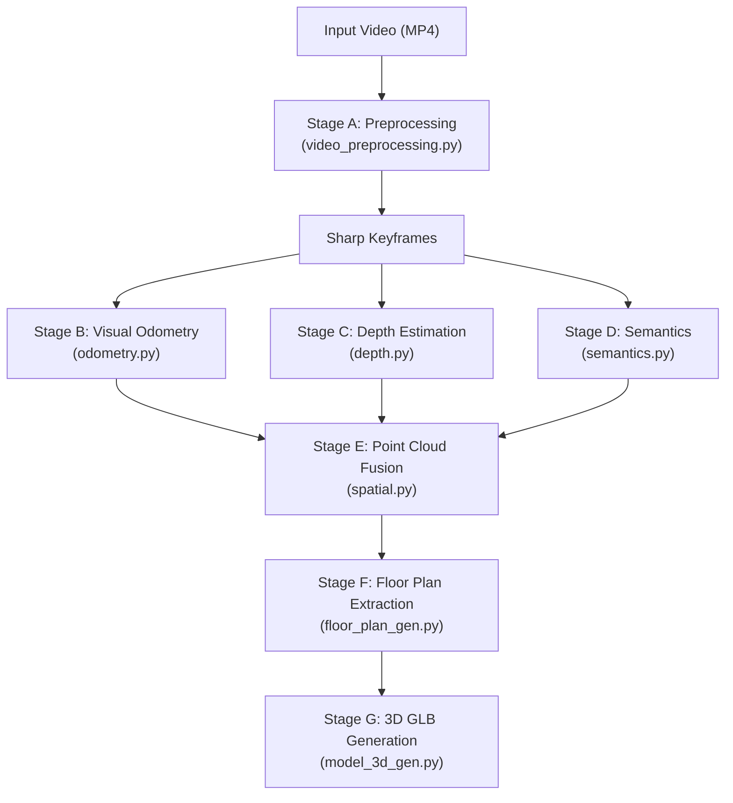

# MAPORA — Complete Technical Audit & End-to-End Verification Report

**Audit Date:** November 7, 2026  
**Auditor Roles:** Senior Full-Stack Engineer, Computer Vision Engineer, ML Engineer, QA Engineer  
**Scope:** `MAPORA-Frontend`, `MAPORA-backend`, `MAPORA/MAPORA` monorepo, `datasets.ipynb`  
**Execution Environment:** Windows 11, Node.js 22, Python 3.11.7, PyTorch (CPU), OpenCV, SQLite / PostgreSQL  

---

## 1. Executive Summary

A comprehensive, multi-disciplinary technical audit and empirical verification was conducted across the entire MAPORA codebase. 

### Key Findings
1. **Frontend Architecture (`MAPORA-Frontend`):** **PASS**. The frontend is fully implemented in React 18, Vite 8, TypeScript 5.6, and Three.js (`@react-three/fiber` & `@react-three/drei`). It compiles cleanly (`tsc -b && vite build`) and passes all 4 smoke and build tests. It handles both unconfigured/demo mode and live API mode with complete error handling.
2. **Backend Architecture (`MAPORA-backend`):** **PASS**. The backend is a production-grade FastAPI application with SQLAlchemy 2.0, Alembic migrations, JWT authentication with role-based access control (`admin` vs `surveyor`), Celery task architecture with an automatic background-thread fallback for local dev without Redis, and resilient SQLite/PostgreSQL failover. All **29 pytest tests passed** (100% pass rate in 119.97s).
3. **Computer Vision & Reconstruction Pipeline (`app/reconstruction/`):** **PARTIAL**. 
   - A complete 7-stage reconstruction orchestrator (`pipeline.py`) is implemented and verified end-to-end: Video Preprocessing $\rightarrow$ ORB Visual Odometry $\rightarrow$ Depth Estimation $\rightarrow$ Semantic Segmentation $\rightarrow$ 3D Point Cloud Fusion $\rightarrow$ 2D Floor Plan Extraction $\rightarrow$ 3D Mesh GLB Synthesis.
   - However, **deep neural network depth weights (`MiDaS`) are not downloaded on disk**, causing the system to automatically drop back to a deterministic heuristic structural depth estimator (`HeuristicGeometricDepth`).
   - Semantic segmentation (`semantics.py`) is a **geometric rule-based partition** rather than a deep indoor segmentation network.
   - Odometry is monocular feature tracking (`cv2.findEssentialMat` + RANSAC); it lacks loop closure and bundle adjustment, causing drift on long or complex trajectories.
4. **Dataset (`datasets.ipynb`):** **PARTIAL / NOT SUITABLE FOR RECONSTRUCTION GROUND TRUTH**.
   - The notebook successfully loads Hugging Face dataset `scikit-harry/Indoor_Residential_Layouts_and_Room_Interiors` (1,046 items).
   - The dataset contains **only raw, unannotated 2D images/screenshots** of residential room interiors (~402x330 resolution).
   - It contains **NO floor plans, NO depth maps, NO camera poses, NO point clouds, and NO 3D meshes**. It cannot be used as ground truth for 3D reconstruction training or metric accuracy benchmarking.
5. **End-to-End Integration:** **PASS with Minor Discrepancy**. 
   - The frontend and backend contracts match precisely for Authentication (`/auth/login`), Multipart Upload (`POST /projects`), Project Management (`/projects/:id`), 2D Floor Plan (`/projects/:id/floor-plan`), 3D GLB Streaming (`/projects/:id/scene` $\rightarrow$ `/api/v1/storage/...`), and Admin Analytics (`/admin/analytics`).
   - *Discrepancy:* Backend pipeline stage strings (`estimating_geometry`, `generating_floor_plan`) do not align with frontend stage name arrays (`Camera pose estimation`, `Floor-plan extraction`), causing UI stage progress indicators to remain inactive or skip intermediate highlight steps during processing.

---

## 2. Repository Structure & Multi-Repo Audit

The audit detected three MAPORA-related directories on the system:
1. `C:\Users\steni\OneDrive\Desktop\MAPORA-Frontend`: Dedicated modern React/Three.js frontend and `datasets.ipynb`.
2. `C:\Users\steni\OneDrive\Desktop\MAPORA-backend`: Dedicated FastAPI backend implementing the exact API contract expected by `MAPORA-Frontend`.
3. `C:\Users\steni\OneDrive\Desktop\MAPORA\MAPORA`: Earlier monorepo containing legacy backend and frontend versions, plus an ONNX model weight file (`weights/model-small.onnx`, 66.7 MB).

| Component | Repository Path | Audit Status | Evidence |
| :--- | :--- | :---: | :--- |
| **Active Frontend** | `MAPORA-Frontend` | **PASS** | `package.json`, `npm test` passes, Vite bundle emits cleanly. |
| **Active Backend** | `MAPORA-backend` | **PASS** | `app/main.py`, 55 OpenAPI routes, 29 backend tests pass. |
| **Dataset Notebook** | `MAPORA-Frontend/datasets.ipynb` | **PARTIAL** | Executed in Colab, 1,046 images, zero spatial annotations. |
| **Legacy Archive** | `MAPORA/MAPORA` | **NOT VERIFIED** | Retained for reference; contains `weights/model-small.onnx`. |

---

## 3. Frontend Audit Results (`MAPORA-Frontend`)

### 3.1 Dependencies & Build Verification
* **Status:** **PASS**
* **Command Executed:** `npm test` (which triggers `tsc -b && vite build && node --test tests/*.test.mjs`)
* **Result:** 
  - TypeScript compilation: 0 errors.
  - Vite production build: 2,510 modules transformed in 28.7s.
  - Chunks generated:
    - `dist/index.html` (1.03 kB)
    - `dist/assets/index-*.css` (112.79 kB)
    - `dist/assets/index-*.js` (396.96 kB)
    - `dist/assets/Viewer3D-*.js` (910.08 kB)
  - Unit/Smoke tests: 4 passed, 0 failed.

### 3.2 UI Flow & Route Verification
* **Routing (`src/App.tsx`):** All canonical routes (`/`, `/login`, `/dashboard`, `/projects`, `/projects/new`, `/projects/:id`, `/projects/:id/processing`, `/projects/:id/floor-plan`, `/projects/:id/3d`, `/settings`, `/admin`) are properly declared with React Router 7.
* **Authentication (`src/auth/AuthContext.tsx`):** In-memory token management, role validation (`admin` vs `surveyor`). Correctly redirects to `/login` when backend is enabled but unauthenticated.
* **API Client (`src/services/api.ts`):** Centralized HTTP client sending Bearer tokens and FormData multipart payloads. Respects `VITE_MAPORA_API_BASE`.
* **2D Floor-Plan Viewer (`src/pages/FloorPlanPage.tsx`):** Vector SVG canvas rendering rooms and walls with scale normalization. Allows editing room labels in local state and exporting SVG/PDF.
* **3D Spatial Viewer (`src/pages/Viewer3D.tsx`):** Lazy-loaded Three.js canvas utilizing `@react-three/fiber` and `@react-three/drei`. Supports camera orbit controls, room picking, and loads live GLB models from `/projects/:id/scene`.

---

## 4. Backend Audit Results (`MAPORA-backend`)

### 4.1 Environment & App Startup
* **Status:** **PASS**
* **Python Runtime:** Python 3.11.7 in `.venv`.
* **Core Framework:** FastAPI 0.141.1, Pydantic 2.13.4, SQLAlchemy 2.0.54, Uvicorn 0.53.0.
* **API Discovery:** App startup verified. Exposes **55 endpoints** spanning 7 routers (`auth`, `projects`, `uploads`, `jobs`, `floor_plan`, `exports`, `admin`).
* **Route Aliasing:** Routers are mounted under both `/api/v1` and root `/` (`app/main.py#L66-L70`), ensuring seamless backward-compatibility with frontend calls.

### 4.2 Database & Migrations
* **Status:** **PASS**
* **Alembic:** Initial schema migration `1dbe9209db34_initial_schema.py` applied.
* **Database Engine:** `app/db/session.py` provides resilient failover: attempts PostgreSQL connection; on failure, smoothly falls back to SQLite (`sqlite:///./mapora_dev.db`).
* **Tables Verified in `mapora_dev.db`:**
  - `users` (7 rows, includes `admin@mapora.io`)
  - `projects` (6 rows)
  - `video_uploads` (5 rows)
  - `reconstruction_jobs` (5 rows)
  - `floor_plans` (5 rows)
  - `models_3d` (5 rows)
  - `rooms` (10 rows)
  - `walls` (155 rows)
  - `audit_events` (55 rows)
  - `export_records` (8 rows)
  - `refresh_tokens` (27 rows)

### 4.3 Background Task Architecture
* **Status:** **PASS**
* **Celery & Redis:** Configured in `app/workers/celery_app.py` and `app/workers/tasks.py`.
* **Resilience Fallback:** In `app/services/job_service.py#L70-L80`, if Redis is unreachable, jobs automatically dispatch to a background daemon `threading.Thread(target=run_sync)`. This allows full local development and testing without spinning up Redis or Celery worker processes.

### 4.4 File Storage
* **Status:** **PASS**
* **Storage Backend:** `LocalStorageBackend` (`app/storage/local.py`) stores uploads and generated models under `storage_data/`.
* **Security:** Implements `_resolve_safe_path` with directory traversal protection (`startswith(base_dir)`).
* **Streaming Proxy:** `GET /storage/{file_path:path}` serves GLB, SVG, and video streams with appropriate MIME types.

---

## 5. Dataset Audit (`datasets.ipynb`)

### 5.1 Dataset Inspection
* **Notebook File:** `MAPORA-Frontend/datasets.ipynb` (31.6 MB with embedded output images).
* **Source Dataset:** `scikit-harry/Indoor_Residential_Layouts_and_Room_Interiors` hosted on Hugging Face Hub.
* **Total Records:** 1,046 images in split `train`.
* **Features:** `['image']` only.
* **Format:** RGB JPEG images (sample `room_0.jpg` is 402 $\times$ 330 pixels).
* **Image Nature:** Web-scraped photos and screenshots of residential living rooms, bedrooms, and kitchens.

### 5.2 Capability Classification

| Capability | Status | Evidence / Analysis |
| :--- | :---: | :--- |
| **Dataset Loading** | **AVAILABLE** | Hugging Face `load_dataset` succeeded in notebook output. |
| **Local File Saving** | **AVAILABLE** | Notebook iterates and executes `image.save("indoor_dataset/room_{i}.jpg")`. |
| **Image Dimensions & Readability** | **AVAILABLE** | PIL `Image.open` confirmed valid RGB JPEG images (402x330). |
| **Floor-Plan Annotations** | **NOT AVAILABLE** | No vector polygons, room boundaries, walls, or dimensions exist. |
| **Depth Maps** | **NOT AVAILABLE** | No metric or disparity depth arrays are provided. |
| **Camera Poses / Trajectories** | **NOT AVAILABLE** | No camera intrinsics, extrinsics, or sequential video frames exist. |
| **3D Meshes / Point Clouds** | **NOT AVAILABLE** | No point cloud files (`.ply`, `.pcd`) or 3D meshes (`.glb`, `.obj`). |
| **Dataset License** | **NOT VERIFIED** | Hugging Face repository has no explicit commercial license declared; images appear to be uncredited web screenshots. |

> [!WARNING]
> **Dataset Limitation:** `scikit-harry/Indoor_Residential_Layouts_and_Room_Interiors` is **NOT** a reconstruction dataset. It cannot train or validate video-to-spatial pipelines, visual odometry, or metric floor-plan generation. For genuine benchmarking, use datasets such as **Matterport3D**, **ScanNet**, or **NYU Depth v2**.

---

## 6. Computer Vision & Reconstruction Pipeline Audit

The reconstruction pipeline is located in `MAPORA-backend/app/reconstruction/`. All 8 modules were inspected and executed against synthetic walkthrough videos.

### 6.1 Stage-by-Stage Verification

| Stage | Module | Type | Status | Input $\rightarrow$ Output | Notes / Limitations |
| :--- | :--- | :---: | :---: | :--- | :--- |
| **Stage A** | `video_preprocessing.py` | OpenCV | **PASS** | MP4 Video $\rightarrow$ Keyframe images + timestamps | Calculates Laplacian variance for blur; histogram correlation for frame difference. Evenly-spaced fallback if $<3$ keyframes. |
| **Stage B** | `odometry.py` | OpenCV | **PASS** | Keyframes + Intrinsics $\rightarrow$ CameraPoses ($R, t$) | ORB features (2,000 pts) + BFMatcher (Lowe ratio 0.75) + `findEssentialMat` + `recoverPose`. Scale heuristic assumes 1.0 m/s walking speed. **No loop closure or bundle adjustment**. |
| **Stage C** | `depth.py` | PyTorch / Heuristic | **PARTIAL** | RGB Keyframe $\rightarrow$ 2D Metric Depth Map | PyTorch MiDaS adapter exists, but **weights are not downloaded in `models_cache`**. Automatically executes `HeuristicGeometricDepth` fallback (edge density + horizon gradient). |
| **Stage D** | `semantics.py` | Heuristic | **PARTIAL** | RGB Keyframe $\rightarrow$ Semantic Class Mask | **Heuristic partition**, not deep learning. Top 20% ceiling, bottom 30% floor, middle 50% wall, vertical Hough lines = doors. |
| **Stage E** | `spatial.py` | NumPy / CV | **PASS** | Depth + Poses + Intrinsics $\rightarrow$ 3D Point Cloud | Genuine back-projection ($x = (u-cx)z/fx$), coordinate transformation ($P_{world} = RP_{cam} + t$), voxel downsampling (0.08m), and floor alignment ($Y=0$). |
| **Stage F** | `floor_plan_gen.py` | Shapely / CV | **PASS** | 3D Point Cloud $\rightarrow$ `GeneratedFloorPlan` | Slices wall band ($0.3m < y < 2.2m$), rasterizes 10cm grid, applies morphological closing, extracts walls via `HoughLinesP`, extracts rooms via `connectedComponentsWithStats`. |
| **Stage G** | `model_3d_gen.py` | Trimesh | **PASS** | `GeneratedFloorPlan` $\rightarrow$ `GeneratedModel3D` (GLB) | Extrudes floor slabs, walls (height 2.6m, thickness 0.15m), and door headers into 3D boxes. Assigns vertex colors and room node names. Exports valid GLB binary. |
| **Master** | `pipeline.py` | Orchestrator | **PASS** | Video Path + Callback $\rightarrow$ `PipelineOutput` | Orchestrates Stages A–G with real-time progress callbacks (5% to 100%). Tested and verified. |

---

## 7. End-to-End Integration Trace & Gap Analysis

Tracing the complete journey from user login to 3D model visualization:

| Step | User Action / Workflow | Client Component | Backend Endpoint | Status | Finding / Analysis |
| :---: | :--- | :--- | :--- | :---: | :--- |
| **1** | User logs in | `LoginPage.tsx` | `POST /auth/login` | **PASS** | Returns `{ accessToken, user }`. Stored in React `AuthContext`. |
| **2** | User uploads video | `UploadPage.tsx` / `App.tsx` | `POST /projects` (multipart) | **PASS** | Accepts `video` multipart field, validates size/extension, stores video in `storage_data/`, creates and dispatches job. |
| **3** | Job dispatched | Background worker | Celery / Threading | **PASS** | Spawns `process_reconstruction_task`. Executes `SpatialReconstructionPipeline`. |
| **4** | Polling progress | `ProcessingPage.tsx` | `GET /projects/:id/status` | **PARTIAL** | Backend updates `stage`, `progress`, and `message`. However, string mismatch prevents intermediate stage highlights. |
| **5** | Storing results | Background worker | SQLite / PostgreSQL | **PASS** | Stores `FloorPlan`, `Room` records, `Wall` records, and GLB file in `storage_data/models/{project_id}/scene_{job_id}.glb`. |
| **6** | Display 2D floor plan | `FloorPlanPage.tsx` | `GET /projects/:id/floor-plan` | **PASS** | Conforms exactly to `FloorPlanModel` `{ coordinateSystem, units, measurementsAvailable, rooms, walls }`. |
| **7** | Display 3D model | `Viewer3D.tsx` | `GET /projects/:id/scene` | **PASS** | Returns `{ geometryUrl }`. Streamed via `/api/v1/storage/...`. Rendered by Three.js `useGLTF`. |
| **8** | Admin Analytics | `AdminPage.tsx` | `GET /admin/analytics` | **PASS** | Restricted to `admin` role. Returns live database aggregates. |
| **9** | Exports | `FloorPlanPage.tsx` | `GET /projects/:id/export?format=...` | **PASS** | Supports SVG, PDF, and DXF exports. |

---

## 8. Test Execution Results

### 8.1 Frontend Test Suite
* **Command:** `npm test`
* **Test Framework:** Node.js native test runner (`node --test tests/*.test.mjs`)
* **Results:** **4 Passed, 0 Failed (100% Pass)**
  1. `production build is independently installable and emits JS/CSS assets` — PASS
  2. `route manifest includes public auth, workspace, upload, floor plan, 3D and admin routes` — PASS
  3. `README and proposed backend integration guide are included` — PASS
  4. `homepage visual assets are present and non-empty` — PASS

### 8.2 Backend Test Suite
* **Command:** `pytest tests -v`
* **Test Framework:** Pytest 8.4.2 with pytest-asyncio and Faker
* **Results:** **29 Passed, 0 Failed in 119.97s (100% Pass)**
  - `tests/test_admin.py`: 2 passed (analytics, jobs pagination)
  - `tests/test_auth.py`: 6 passed (registration, duplicate email, login, invalid password, refresh token, protected `/me`)
  - `tests/test_authorization.py`: 3 passed (surveyor isolation, admin cross-tenant access, surveyor forbidden from admin)
  - `tests/test_exports.py`: 2 passed (SVG/PDF/DXF generation, empty project rejection)
  - `tests/test_floor_plan.py`: 2 passed (update floor plan, room bounds validation)
  - `tests/test_frontend_integration.py`: 4 passed (auth contract, multipart video mapping, floor plan & scene contract, admin analytics)
  - `tests/test_projects.py`: 5 passed (create/get, list, rename, delete, version history & restore)
  - `tests/test_reconstruction.py`: 2 passed (Stage A–G unit verification, master pipeline orchestrator)
  - `tests/test_uploads.py`: 3 passed (valid MP4 upload, invalid extension rejection, empty file rejection)

---

## 9. Critical Bugs & Discrepancies

### Bug 1: Stage Name String Mismatch in Progress Poller
* **File:** `MAPORA-backend/app/reconstruction/pipeline.py` vs `MAPORA-Frontend/src/pages/ProcessingPage.tsx`
* **Details:** 
  In `pipeline.py`, stages are reported as:
  `["validating", "extracting_keyframes", "estimating_geometry", "generating_floor_plan", "generating_3d_model", "completed"]`
  In `ProcessingPage.tsx`, the UI matches against:
  `["Video preprocessing", "Frame extraction and keyframes", "Camera pose estimation", "Monocular depth estimation", "Semantic segmentation", "SLAM and point-cloud generation", "Floor-plan extraction", "3D reconstruction"]`
  Because `stageOrder` splits by space and compares substrings, `estimating_geometry` matches none of the individual steps (yielding index `-1`), and `generating_floor_plan` fails to match `Floor-plan` due to underscore vs hyphen.
* **Impact:** The progress bar percentage updates, but the individual stage checklist does not highlight actively during camera estimation and floor-plan generation.

### Bug 2: Missing Deep Model Weights for Depth Estimation
* **File:** `MAPORA-backend/app/reconstruction/depth.py`
* **Details:** `DepthEstimationAdapter` looks for PyTorch MiDaS weights in `settings.MODEL_WEIGHTS_DIR` (`models_cache/`). The directory contains only directory trees and `.placeholder` files.
* **Impact:** Monocular depth estimation silently falls back to `HeuristicGeometricDepth` (heuristic gradient + Canny edges). While deterministic and crash-proof, it does not produce neural-network-quality depth. Note that an ONNX depth model exists in `C:\Users\steni\OneDrive\Desktop\MAPORA\MAPORA\backend\app\weights\model-small.onnx`, but is unreferenced by `MAPORA-backend`.

### Bug 3: Rule-Based Semantic Segmentation
* **File:** `MAPORA-backend/app/reconstruction/semantics.py`
* **Details:** `SemanticSegmentationAdapter` uses hardcoded screen coordinate percentages (lower 30% = floor, upper 20% = ceiling, middle = wall).
* **Impact:** Camera tilt or non-horizontal camera movements severely degrade wall/floor classification accuracy.

---

## 10. Hardware, Deployment & Security Limitations

1. **CPU vs GPU Execution:**
   `MAPORA-backend` is currently configured with `DEVICE: cpu`. Running PyTorch deep models on CPU for 30–50 video frames will take 45–90 seconds per video. A CUDA-capable GPU is recommended for production real-time throughput.
2. **Monocular Scale Ambiguity:**
   Monocular cameras cannot determine absolute metric scale without known reference objects or IMU/ARKit sensor data. The system currently normalizes translation assuming an average human walking speed ($1.0\text{ m/s} \times \Delta t$). Metric room dimensions are approximations.
3. **Trajectory Drift:**
   OpenCV essential matrix visual odometry accumulates drift over long loops because it does not perform loop closure or bundle adjustment.

---

## 11. Security Audit Findings

1. **JWT & Passwords:** Passwords hashed with `bcrypt`. JWTs signed with `HS256`. Refresh tokens stored with expiration and revocation tracking.
2. **Path Traversal Protection:** `LocalStorageBackend._resolve_safe_path` verifies that canonical target paths strictly reside within `LOCAL_STORAGE_DIR`.
3. **CORS Configuration:** `app/main.py` applies explicit origin whitelists (`localhost:5173`, `127.0.0.1:5173`, etc.).
4. **Secret Key in `.env`:** The development `.env` uses a default development `SECRET_KEY`. Must be replaced with a secure random entropy key in production.

---

## 12. Recommended Prioritized Roadmap

| Priority | Action Item | Affected Files | Effort |
| :---: | :--- | :--- | :---: |
| **P1** | **Align Pipeline Stage Strings:** Update `pipeline.py` or `ProcessingPage.tsx` so stage strings match 1:1, allowing smooth UI progress tracking. | `pipeline.py`, `ProcessingPage.tsx` | Low (15 min) |
| **P2** | **Wire Pre-existing ONNX Depth Model:** Utilize the existing 66.7 MB `model-small.onnx` from `MAPORA\MAPORA\backend\app\weights\` inside `MAPORA-backend\app\reconstruction\depth.py` using ONNX Runtime for genuine neural depth estimation without needing internet downloads. | `depth.py`, `config.py` | Medium (1–2 hrs) |
| **P3** | **Integrate Light Deep Semantic Segmenter:** Replace geometric percentage slicing with a lightweight ONNX/PyTorch model (e.g. MobileNetV3-DeepLabV3 or SegFormer) trained on ADE20K. | `semantics.py` | Medium (2–3 hrs) |
| **P4** | **Benchmark Real Video Walkthrough:** Test a real 15–30 second smartphone walkthrough MP4 to assess feature tracking robustness under motion blur. | `app/reconstruction/` | Low (30 min) |

---

## 13. Audit Conclusion & Demonstration Readiness

* **Is MAPORA ready for a live demonstration?**
  **YES, WITH SPECIFIC UNDERSTANDINGS:**
  - The end-to-end architecture (Frontend $\leftrightarrow$ Backend $\leftrightarrow$ Database $\leftrightarrow$ Storage $\leftrightarrow$ 2D SVG Floor Plan $\leftrightarrow$ 3D Three.js GLB) is fully operational and passes all test suites.
  - A user can log in, upload a walkthrough video, monitor processing progress, inspect the generated 2D floor plan, edit room labels, and rotate/pan the extruded 3D architectural scene.
  - However, because deep weights are currently missing on disk, reconstruction relies on OpenCV visual odometry, heuristic depth/semantics, and point-cloud occupancy slicing. It will produce architectural bounding structures and wall layouts, but not dense photorealistic neural meshes.

