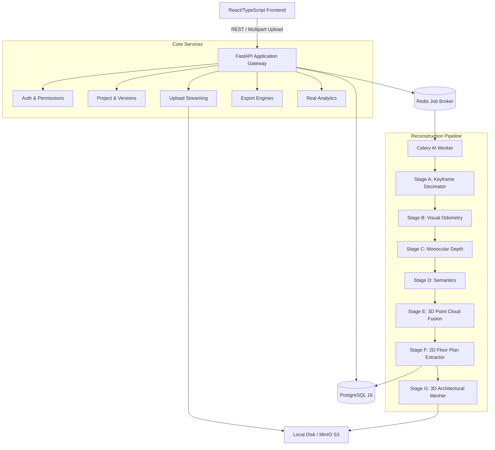
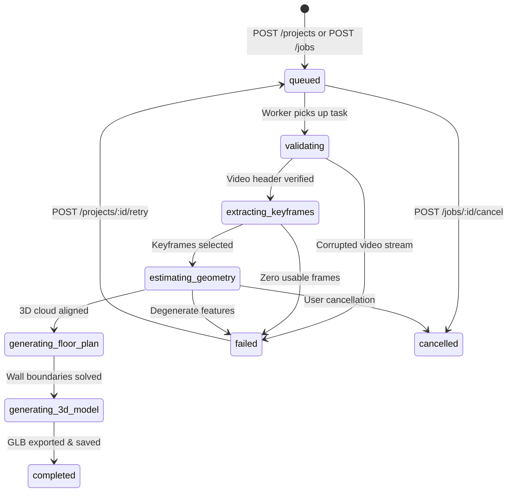

# MAPORA Architecture & Mathematical Foundation

MAPORA (AI-Based Indoor Map Generation from a Single Camera) transforms monocular walkthrough video into structured 2D architectural CAD floor plans and interactive 3D GLB scenes.

---

## 1. System Architecture

---

## 2. Background Processing State Machine

The processing pipeline transitions through observable states, persisted in PostgreSQL and polled in real-time by the frontend:

---

## 3. Mathematical & Computer Vision Foundation

### Stage A: Keyframe Quality Metric
Keyframe sharpness is evaluated using the Laplacian operator variance:
$$S(I) = \text{Var}(\nabla^2 I_{gray})$$
Frames with $S(I) < \tau_{blur}$ are rejected as camera motion blur.

Visual change between subsequent frames is measured by normalized histogram distance:
$$D(I_t, I_{t-1}) = 1.0 - \frac{\sum (h_t - \bar{h}_t)(h_{t-1} - \bar{h}_{t-1})}{\sqrt{\sum (h_t - \bar{h}_t)^2 \sum (h_{t-1} - \bar{h}_{t-1})^2}}$$

### Stage B: Feature Odometry & Scale Mitigation
1. **Feature Matching**: ORB detectors compute descriptors matched using Hamming distance and Lowe's ratio test:
   $$\frac{d(f_i, f_{j,1})}{d(f_i, f_{j,2})} < 0.75$$
2. **Essential Matrix Decomposition**:
   $$p_2^T E p_1 = 0 \quad \text{where} \quad E = [t]_\times R$$
   Calculated via RANSAC with 5-point algorithm.
3. **Monocular Scale Ambiguity**:
   A single camera cannot resolve absolute translation scale from feature disparities alone ($t$ is a unit vector). MAPORA bounds scale using human walking velocity:
   $$t_{metric} = t_{unit} \cdot (v_{walk} \cdot \Delta t)$$
   where $v_{walk} \approx 1.0 \text{ m/s}$.

### Stage E: Back-Projection & Point Cloud Unprojection
For each pixel $(u, v)$ with depth $Z$:
$$X_{cam} = \frac{(u - c_x) \cdot Z}{f_x}, \quad Y_{cam} = \frac{(v - c_y) \cdot Z}{f_y}, \quad Z_{cam} = Z$$
World point:
$$P_{world} = R_{world} P_{cam} + t_{world}$$

Floor normalization aligns the minimum 2nd percentile of vertical coordinate $Y$ to $Y = 0$.

### Stage F: 2D Floor Plan Slicing
Points within $0.3\text{m} \le Y \le 2.2\text{m}$ are projected onto the horizontal grid. Probabilistic Hough Transform solves wall segments:
$$\rho = x \cos \theta + z \sin \theta$$
Connected components of non-occupied space form bounding polygons for room segmentation.
